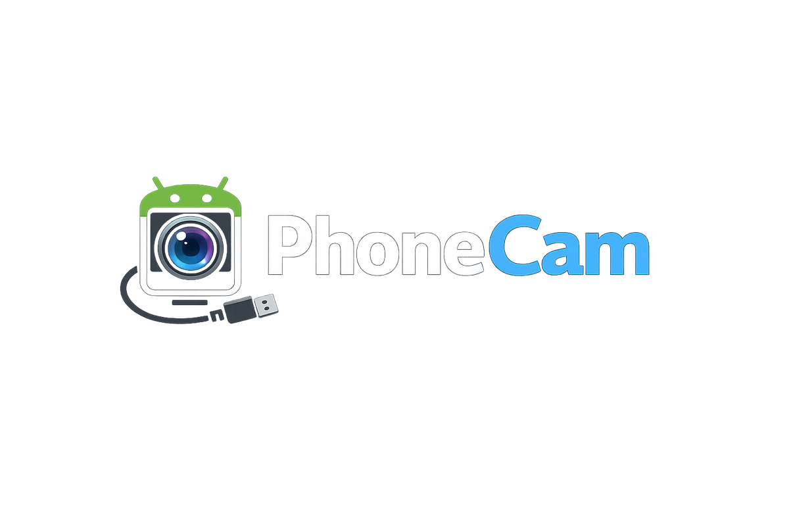

# PhoneCam



Turn an Android phone into a fast, high-quality **USB webcam** on Windows — recognized as a real camera device by every app (Zoom, Teams, Chrome, Windows Camera, OBS), not just an OBS plugin.

USB only. No root. Free, open-source, no watermark.

## Why

Every phone-as-webcam app (DroidCam, Iriun, Camo, iVCam) uses the same underlying trick: a companion PC driver that registers a virtual camera, fed by a stream from a phone-side app over USB. There's no shortcut around this on a non-rooted phone — Android only lets the phone *itself* enumerate as a real USB camera (`DeviceAsWebcam`) on Android 14+ with OEM support, which most phones (including the reference device for this project, a Redmi Note 8 on Android 11) don't have.

So PhoneCam plays that same architecture straight, and competes on what the paid incumbents under-serve or paywall:

- **All camera controls free** — exposure, focus (incl. tap-to-focus), zoom, torch, white balance, lens switch — driven live from the PC.
- **Synced audio is planned** over the same USB cable; it is not implemented yet.
- **No extra USB transport driver** — USB tethering instead of forcing users through Developer Options → USB debugging or a custom USB driver install. Once the Windows companion and virtual camera are installed, enable tethering and open both apps. The initial Windows installation still needs admin.
- **Genuinely low latency** — hardware H.264, zero-copy capture, low-latency decode; targeting sub-150ms glass-to-glass.
- **No watermark, no paywall, no subscription.**

## Architecture

```
Android app                     USB                  Windows host              Virtual camera
Camera2 → MediaCodec   ──►  USB tethering  ──►   Media Foundation    ──►   MFCreateVirtualCamera
(H.264, zero-copy)          or USB debugging     H.264 decode              seen by ALL apps
     └────────────────── control channel (bidirectional) ───────────────────┘
```

The phone captures and hardware-encodes video over USB, and a Windows host process decodes it and feeds a registered [`MFCreateVirtualCamera`](https://learn.microsoft.com/en-us/windows/win32/api/mfvirtualcamera/) media source — which Windows' Frame Server serves to both Media Foundation apps (Chrome, Windows Camera, new Teams) and DirectShow apps (Zoom, classic OBS) at once. A bidirectional control channel carries camera commands (PC → phone) and capabilities/telemetry (phone → PC).

PhoneCam supports two USB connections:

- **USB tethering** — enable USB tethering on the phone. Windows uses its built-in network driver; video and camera controls work without Developer Options or a custom driver. This is preferred when the tethered link is available.
- **USB debugging (ADB)** — enable Developer Options → USB debugging. The host uses ADB forwarding over the authorized local ADB connection.

The host automatically selects tethering when available, otherwise it uses ADB. You can also select either path from the Windows tray menu. There is no QR pairing or application-level authentication. Tethered TCP listeners bind only to the phone's USB-tethering interface; ADB keeps its authorized local sockets. **Stop stays stopped until Start**, and the Windows virtual camera remains registered. Tethered control and video are plaintext and unauthenticated, so use a trusted, directly connected USB host.
See [security.md](docs/security.md) for the trust boundary and accepted limits. CLI transport
overrides `--net` and `--adb` remain available for development.

**Background rule:** the phone app continues in the background only while it is
connected and streaming video. Leaving Ready, Connecting, or Retry shuts down
its service, listeners, wake lock, and notification. If a hidden stream loses
its connection, it exits too; reopen the phone app to reconnect. This does not
change the saved Stop intent or erase settings.

Both endpoints must use **control protocol v8**. Building or testing a host from
`windows/build/` does not update the installed Windows app. See
[build.md](docs/build.md#updating-an-installed-windows-host) for deployment.

Earlier USB measurements on the reference phone (Redmi Note 8, Android 11):

| Transport | Reference-relative timing (not absolute latency) |
|---|---|
| USB (adb) | 1–2 ms |

These figures measure changes in delay relative to a reference frame, not absolute camera-to-PC or glass-to-glass latency. The clock-offset calculation also cancels the reference frame's pipeline delay; absolute latency still needs a separate measurement.

Current design: [`docs/architecture.md`](docs/architecture.md).
Remaining checks: [`plan.md`](plan.md).
Network trust boundary and accepted plaintext limits: [`docs/security.md`](docs/security.md).

## Status

Not yet a finished product — actively developed, most of the core pipeline works and has been verified against real hardware, not just in theory.

**Working and verified live**, streamed from a real phone into a real virtual camera visible in Zoom/OBS/Chrome/Windows Camera:
- Full ADB-based pipeline: capture → H.264 encode → USB transport → Media Foundation decode → virtual camera, 1080p30.
- Live camera controls from the PC (zoom, exposure, focus incl. tap-to-focus, torch, lens switch, bitrate) with capability-driven UI (never shows a control the phone doesn't actually support).
- Adaptive bitrate, thermal-aware, with live stats telemetry.
- Connected streaming continues while the phone app is backgrounded; disconnected/retrying work exits when the UI closes. A disconnected hidden stream must be reopened rather than retrying indefinitely in the background.
- **USB tethering transport — the one to use.** No Developer Options or custom transport driver required. Windows binds its built-in RNDIS driver automatically, and the host finds the phone at the tethered link's gateway — no IP to type. Both video and controls were verified over tethered TCP with no ADB forwarding. Tethered listeners bind only to the USB-tethering address; traffic is plaintext and there is no app-layer authentication.
- **Camera controls work without USB debugging** for the first time, over that same tethered link — the control channel was always just TCP; it only ever used adb to get a route. All seven tray controls populate from the phone's real reported capabilities.
- **Current validation:** ADB and tethering each delivered 1080p/30; live transport switching kept one virtual-camera registration. Background shutdown tests passed three consecutive device runs. Physical unplug/replug, changing tether addresses, and debugging-off operation were not separately retested on this USB-only build. See [validation results](docs/usb-validation-2026-11-08.md).

- The virtual camera now genuinely advertises 4 resolutions (1920x1080, 1280x720, and true portrait 1080x1920/720x1280) — the consuming app picks one, same as any real UVC webcam. Confirmed via `ffmpeg -f dshow -list_options` and independently via a native Media Foundation probe.
- Rotation/mirror (0°/90°/180°/270° + mirror), applied PC-side, live from the tray — defaults to 90° clockwise (the reference mounting is the phone held vertically; a landscape sensor frame needs that rotation to look normal). Verified live against the running virtual camera, including the default applying automatically with no tray interaction needed.
- **Known platform limitation, not yet worked around:** the two portrait sizes render correctly in native Media Foundation probes but are corrupted through Windows' DirectShow compatibility bridge (`VCAMDS`). Classic DirectShow-based apps may be affected; landscape sizes worked in the tested consumers. See [the diagnosis](docs/architecture.md#portrait-through-directshow).
- Full tray controls: camera/lens switch, zoom, exposure, torch, focus mode, plus the rotation/mirror above and a read-only resolution display — all real submenus, not stubs, populated from the phone's own reported capabilities (a control never appears unless the phone actually supports it). Resolution is display-only by design: the consuming app picks it, exactly like a real webcam, so you set it in OBS/Zoom/Chrome's own device settings.

**Not built yet:** a proactive nudge for first-time users and synced audio. Wi-Fi/RTP and AOA are not supported transports.

See [`docs/architecture.md`](docs/architecture.md) for the current design and links to the original development journal. Historical media experiments are retained in [`bench/results.md`](bench/results.md); the closed wireless investigation is distilled in [`networking.md`](networking.md).

## Project layout

- `android/` — the installed Kotlin/Camera2 app (capture, encode, transport, control, foreground service).
- `windows/common/` — shared C++ static lib: wire framing, shared-memory frame ring, logging.
- `windows/host/` — `phonecam-host.exe`: USB transports (ADB and tethered TCP), Media Foundation decode, virtual-camera control.
- `windows/vcam/` — `phonecam-vcam.dll`: the `MFCreateVirtualCamera` COM media source.
- `windows/installer/` — Inno Setup packaging for the host, ring service, virtual-camera DLL, and bundled ADB.
- `proto/` — shared FlatBuffers schemas (wire + control protocol) — the contract both sides build against.
- `docs/` — architecture (the authoritative, detailed project history), protocol specs, build instructions.

## Building

See [`docs/build.md`](docs/build.md).

## License

[GPL-3.0-or-later](LICENSE).
